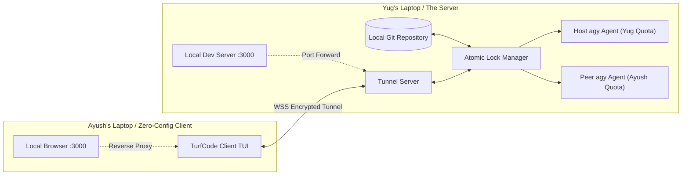

# TurfCode CLI — Product & Technical Architecture Specification

> **Real-time multiplayer AI coding in the terminal.**  
> Pair program in real time, orchestrate parallel AI coding agents, and lock files atomically without git merge conflicts.

---

## 1. Executive Summary & Vision

AI coding tools (Cursor, Claude Code, Antigravity) are designed as single-player experiences. When two developers want to collaborate on a codebase using AI, they are forced into screen sharing, git branch ping-pong, or clunky browser web IDEs that developers dislike.

**TurfCode CLI** solves this by turning the native terminal into a **real-time multiplayer cockpit**:
- Two developers (e.g. Yug & Ayush) join a shared session in seconds.
- The host device acts as the low-latency live file server.
- Both developers can spawn and steer autonomous AI agents (starting with Antigravity `agy`) simultaneously.
- An **Intent Board** with **Atomic Sequence File Locking** guarantees that agents never overwrite each other's code or cause merge collisions.
- AI token quotas are strictly isolated: each developer uses their own Antigravity account and session credentials.

---

## 2. The Roles: Host vs. Peer



### The Host (Yug)
- **Authoritative File & State Anchor**: Owns the primary git repository on disk.
- **Compute Server**: Runs the file watchers, git operations, local dev servers, and hosts the session daemon.
- **Merge Authority**: When an agent finishes a task, the merge resolution and automated gate checks execute on the host machine using the host's quota and git identity ([MD-039]).

### The Peer (Ayush)
- **Zero-Config Collaborator**: Does **not** clone the repo, does not run `npm install`, and does not need local toolchains installed.
- **Local Input Loop**: Types prompts and commands locally with zero keystroke lag; only completed prompts and file transactions cross the network ([MD-020]).
- **Independent Quota**: Supplies his own Antigravity auth token/session ID during the encrypted join handshake. Ayush's agents consume Ayush's quota, never Yug's ([MD-019]).

---

## 3. Visual Identity: The Electric Lime Cockpit

Standard terminal monochrome is replaced immediately upon entering TurfCode:
- **Palette**: Dark obsidian-emerald background (`#081008`), high-contrast Electric Lime borders and active tab indicators (`#39FF14`).
- **Layout (Herdr-Style Vertical Split)**:
  - **Left 30% (Intent Board)**: Shared task cards (`[QUEUED]`, `[IN PROGRESS]`, `[DONE]`), live File Lock Table with padlock badges (`🔒`), and connected peers.
  - **Right 70% (Agent & Terminal Pane)**: Multi-tab terminal cockpit displaying live streaming outputs from parallel agents and native shells.
  - **Keybindings**: `Tab` cycles focus, `Ctrl+B` collapses/expands Intent Board, `Ctrl+1..9` jumps between agent tabs, `[D]` opens live colorized git diffs, `[F]` toggles directory tree.

---

## 4. Concurrency & The Filesystem Engine

The hardest problem in multiplayer AI coding is preventing race conditions when parallel agents modify code. TurfCode implements a **three-tier safety architecture**:

### 1. Pre-Flight Intent & Sequence Declaration ([MD-040])
Before any AI agent can touch workspace code, it must declare:
1. **The Intent**: What feature or bug is being addressed.
2. **The File Sequence**: The exact ordered sequence of files to be modified (e.g. `[1. src/models/user.ts -> 2. src/routes/auth.ts -> 3. test/auth.test.ts]`).

### 2. Atomic Multi-File Locking
- TurfCode's Lock Manager attempts to lock **all files in the sequence simultaneously** before the agent writes a single byte.
- If **any** file in the sequence is currently held by another agent or peer, the entire operation **fails fast** with an explicit diagnostic:
  ```text
  [LOCK CONFLICT] Cannot acquire lock on src/routes/auth.ts (Held by Yug on Task #1).
  ```
- No partial writes, no half-finished dirty states, no deadlocks.

### 3. Isolated Git Worktrees per Agent ([MD-022])
- Each agent runs in its own isolated worktree under `.turf/worktrees/<task-id>`.
- Agents write to independent git checkouts. Even if two agents modify adjacent files, they never corrupt the primary working tree.
- On task completion, TurfCode verifies tests, squash-merges the worktree branch into `main` ([MD-033]), dissolves the file locks, and commits with Git Co-Authorship trailers ([MD-012]).

---

## 5. Prior Art & Reusable Foundations (No Starting from Zero)

To avoid trial-and-error mistakes, TurfCode CLI directly leverages proven open-source architectures:

1. **`projects/turfcode` (Internal Battle-Tested Core)**:
   - `server/tui.js`: Blessed 3-pane cockpit with collapsible sidebar (`«` / `»`).
   - `spawnTerminalProcess()`: Solved the Blessed `screen.spawn()` UI erasure bug by streaming subprocess stdout/stderr directly into terminal log boxes without wiping the alternate screen buffer.
   - `node-pty`: Native pseudo-terminal management for Windows (ConPTY) and Linux/macOS.
   - Port conflict prevention: `isPortAvailable()`, `killProcessOnPort()`.
2. **Herdr (`herdrdev/herdr`)**:
   - High-density terminal multiplexing and subprocess containment patterns.
3. **Ephemeral Tunneling (Cloudflare Quick Tunnel / localtunnel)**:
   - Instant WSS tunnel generation with random 6-character room codes (`TURF-7A9B`) for seamless peer connection across NATs and firewalls.

---

## 6. Target Codebase Architecture

```text
projects/turfcode-cli/
├── bin/
│   └── turf.js                 # Unified CLI launcher & flag parser (MD-038)
├── src/
│   ├── cockpit.js              # Blessed Electric Lime TUI layout & keybindings (MD-001, MD-004, MD-032)
│   ├── intent-board.js         # Shared task state machine & UI component (MD-014, MD-037)
│   ├── lock-manager.js         # Atomic multi-file lock coordinator & heartbeat lease (MD-002, MD-007, MD-040)
│   ├── worktree-manager.js     # Git worktree isolation, auto-squash & cleanup (MD-022, MD-033)
│   ├── agent-runner.js         # Direct binary agy execution with credential injection (MD-003, MD-010, MD-029)
│   ├── tunnel.js               # Ephemeral WSS tunnel server & port forwarder (MD-006, MD-031)
│   ├── client.js               # Peer client connection & local input loop (MD-020, MD-025)
│   └── diff-viewer.js          # Colorized live git diff inspection component (MD-016)
├── test/
│   ├── lock-manager.test.js    # Unit tests for atomic multi-file locking
│   └── worktree.test.js        # Unit tests for worktree creation and fast-forward merging
├── README.md                   # Project overview & quick start
├── product.md                  # This master specification
├── microdecisions.md           # Master ADR log (MD-001 through MD-040)
└── package.json                # Pure Node ESM package definition (MD-028)
```

---

## 7. Milestone Roadmap

- **Milestone 1: The Electric Lime Cockpit & TUI Foundation**
  Port and modernize the Blessed TUI from `projects/turfcode`, enforce the Electric Lime theme token scale, implement Herdr-style navigation (`Tab`, `Ctrl+B`, `Ctrl+1..9`), and verify subprocess containment.
- **Milestone 2: Atomic Multi-File Lock Engine & Worktree Isolation**
  Build `lock-manager.js` and `worktree-manager.js`. Test atomic sequence locking, heartbeat lease auto-dissolution, and clean squash-merging.
- **Milestone 3: Agent Runner & Credential Passthrough**
  Build `agent-runner.js` to spawn `agy` binaries directly with injected environment credentials (`GEMINI_API_KEY`, `AGY_SESSION_ID`).
- **Milestone 4: Ephemeral Tunneling & Peer Client Loop**
  Implement `tunnel.js` and `client.js` with room code pairing, 30ms throttled frame streaming, and dev server reverse port forwarding.
- **Milestone 5: Dogfooding & Firstmate Verification**
  Run 2-person dogfood test between Yug and Ayush, verify git co-authorship commits, and gate through `no-mistakes-prod-only`.
